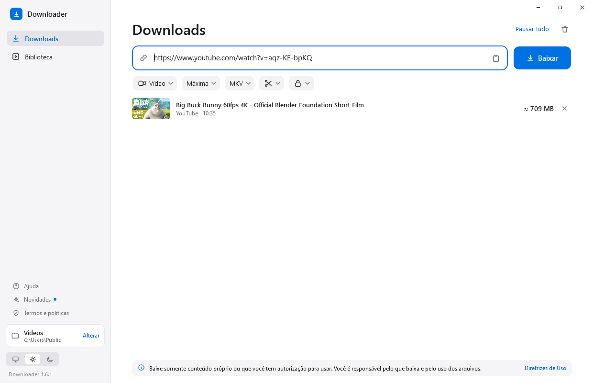
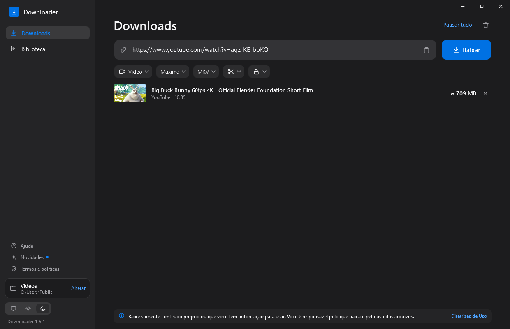

# Downloader

Aplicativo para Windows que baixa vídeos e áudios a partir de um link. Você cola o link, vê o tamanho antes de baixar e escolhe o formato.



## Baixar

Baixe o `Downloader.exe` na [página de versões](https://github.com/EMANON2U/Downloader/releases/latest) e abra o arquivo. Ele oferece a instalação, que não precisa de administrador.

O programa ainda não tem assinatura digital, então o Windows pode mostrar "O Windows protegeu o computador". Para continuar, clique em **Mais informações** e em **Executar assim mesmo**. O SHA-256 de cada versão está nas notas da versão.

**Requisitos:** Windows 10 ou 11, 64 bits. Os testes foram feitos no Windows 10 22H2; o Windows 11 ainda não foi testado.

## O que ele faz

- **Formatos:** vídeo em MKV ou MP4, áudio em MP3, WAV ou M4A, ou vídeo e áudio em arquivos separados.
- **Tamanho antes de baixar:** com título, miniatura e duração, sempre que o site informa.
- **Só um trecho:** baixa apenas o intervalo escolhido, com corte exato ou rápido.
- **Fila:** vários links de uma vez, com pausa, retomada e cancelamento.
- **Biblioteca:** o que você baixou neste PC, com busca e opção de baixar de novo.
- **Conteúdo restrito:** usa o login do navegador ou um arquivo de cookies, e só se o site pedir.
- **Erros claros:** causa, o que fazer, código e relatório que você revisa antes de compartilhar.
- **Temas:** claro, escuro ou o do Windows.

Funciona com YouTube e com os muitos sites compatíveis com o [yt-dlp](https://github.com/yt-dlp/yt-dlp). Cada site muda com o tempo, então a compatibilidade não é garantida.



## Uso responsável

Baixe somente conteúdo próprio ou que você tem autorização para usar. Você é responsável pelo que baixa e pelo uso dos arquivos, e os termos de alguns sites proíbem o download. As regras completas estão em [`src/legal.md`](src/legal.md) e dentro do programa, em **Termos e políticas**.

## Privacidade

O programa não tem conta, anúncios nem telemetria. Ao colar um link, ele consulta o site para mostrar as informações do vídeo. A [Política de Privacidade](src/legal.md) descreve o que fica no seu computador e o que acessa a internet.

## Para desenvolver

Feito em C# 5 e WPF sobre o .NET Framework 4.8, compilado com o `csc` do próprio Windows. Não precisa de SDK nem de NuGet.

**1. Baixe os componentes para a pasta `deps\`.** Eles não ficam no repositório:

| Arquivo | Origem |
|---|---|
| `yt-dlp.exe` | [yt-dlp](https://github.com/yt-dlp/yt-dlp/releases) |
| `ffmpeg.exe` e `ffmpeg-LICENSE.txt` (cópia do `LICENSE.txt`) | Variante `win64-lgpl` do [FFmpeg-Builds](https://github.com/BtbN/FFmpeg-Builds/releases) |
| `deno.exe` | [Deno](https://github.com/denoland/deno/releases) |

**2. Compile:**

```powershell
powershell -File build.ps1                # gera dist\release\Downloader.exe
```

Para testar sem mexer na instalação real, defina `DOWNLOADER_HOME` e `DOWNLOADER_DATA` com pastas temporárias.

| Caminho | Conteúdo |
|---|---|
| `src\App.cs` | Fila, downloads, Biblioteca e interface |
| `src\Setup.cs` | Instalação, desinstalação e componentes embutidos |
| `src\Errors.cs` | Catálogo de erros, registro técnico e relatório |
| `src\Estimate.cs` | Cálculo do tamanho antes de baixar |
| `src\MainWindow.xaml` | Telas e estilos |
| `src\ajuda.md`, `src\legal.md` | Textos da Ajuda e de Termos e políticas |
| `CHANGELOG.md` | Texto de Novidades. O build exige uma seção para a versão compilada |

## Licença

© 2026 ArchiveByLOPES. Todos os direitos reservados: veja [`LICENSE`](LICENSE). Os componentes de terceiros têm licenças próprias, listadas em [`THIRD-PARTY-NOTICES.txt`](THIRD-PARTY-NOTICES.txt).

**Contato:** contato.resoup@gmail.com
